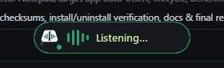
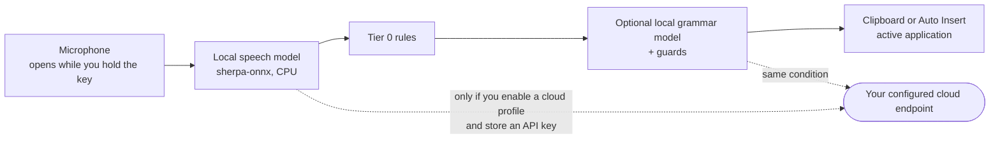

<div align="center">
  <br />
  <a href="https://keyreed-website.vercel.app">
    
  </a>
  <br /><br />
  <p>
    <a href="https://github.com/Shanmukh-l33t/keyreed/releases/latest"></a>
    <a href="https://github.com/Shanmukh-l33t/keyreed/actions/workflows/ci.yml"></a>
    
    
    
  </p>
  <p>
    <a href="https://keyreed-website.vercel.app"><strong>Website</strong></a> ·
    <a href="https://github.com/Shanmukh-l33t/keyreed/releases/latest"><strong>Download</strong></a> ·
    <a href="docs/installation.md"><strong>Install guide</strong></a> ·
    <a href="docs/architecture.md"><strong>Architecture</strong></a> ·
    <a href="docs/troubleshooting.md"><strong>Troubleshooting</strong></a> ·
    <a href="CONTRIBUTING.md"><strong>Contribute</strong></a>
  </p>
</div>

---

# KeyReed

**KeyReed is an open-source, local-first voice dictation app for Windows.** Hold a shortcut, speak, release. KeyReed transcribes on your own CPU, cleans the text up, and hands it to whatever application you were using.

It is built as an inspectable alternative to cloud dictation tools such as Wispr Flow: you can read the code, run it offline, and decide for yourself whether any audio ever leaves the machine.

> **Status:** release **0.3.0** (Windows 11 x64 verified). The Windows build is unsigned; read [Known limits](#known-limits) for details.

## Quick start

1. Download **`KeyReed-Setup-x64.exe`** (`17.8 MB`) from the [latest release](https://github.com/Shanmukh-l33t/keyreed/releases/latest).
2. Run it. Windows SmartScreen may warn, because the file is unsigned. See [Verifying a download](docs/installation.md#verify-your-download).
3. On first launch, KeyReed opens **Settings** automatically if the default speech model is not installed yet. Click **Download** next to **Local Speech Engine** to download `Parakeet TDT 0.6B v2` (~460 MB, with live MB/% progress, cancellation support, and compile-time SHA-256 verification).
4. Pick your microphone in **Settings** and click **Test Mic** to verify your input level.
5. Focus any text field, hold **Right Ctrl**, speak, and release.
6. KeyReed transcribes your speech, applies your selected writing mode, and **automatically inserts the text into your active window** (falling back to the clipboard if the target field is a password box, elevated, or unfocused).

No Rust, Python, Visual Studio or command line needed. Prefer one offline download? Use `keyreed-0.3.0-windows-x64-full-offline.zip`, which already contains the speech and grammar models.

## Why KeyReed

| | |
| --- | --- |
| **Open source** | A public Rust workspace under MIT or Apache-2.0, your choice. |
| **Local by default** | The default profile, Maximum Privacy (100% Offline), makes no network call for audio or text. |
| **System-wide** | A global shortcut that works in any application, not a plugin for one editor. |
| **Six writing modes** | Smart, Exact, Professional, Casual, Technical and Terminal / Code. |
| **CPU only** | Speech and grammar models run on the processor. No dedicated GPU required. |
| **Checked models** | Every model file is verified against a compile-time size and SHA-256 before it loads. |

## What it looks like

<p align="center">
  
  &nbsp;&nbsp;
  
</p>
<p align="center"><sub>Real captures from KeyReed 0.3.0 on Windows 11.</sub></p>

The [website](https://keyreed-website.vercel.app) has an animated walkthrough of the dictation flow. It is an illustration, not a recording.

## Features

- **Hold-to-talk or toggle-to-talk.** Right Ctrl by default; the shortcut is a preset list in Settings. Escape cancels a recording.
- **Writing modes.** See [below](#writing-modes). Cycle them with Ctrl+Shift+Space, or let automatic app-context adaptation choose.
- **Grammar correction.** Deterministic Tier 0 rules first (fillers, stutters, spoken self-corrections, casing, your vocabulary), then an optional local grammar model, then guards that fall back to Tier 0 if the model output drifts.
- **Personal vocabulary.** Teach it names and jargon in Settings (used both for Sherpa transducer hotword biasing and Tier 0 casing).
- **Output choice.** Auto Insert (default: types into the focused field, falls back to the clipboard for password fields or elevated windows), Clipboard Only, or Ask Before Inserting (3-option `Yes` / `No` / `Cancel` dialog).
- **Microphone selection & diagnostics**, a non-activating floating mic pill with 50 ms live waveform animation, **Test Mic** diagnostics, audio cues, **Reset Defaults**, and optional startup with Windows (off by default).
- **Six speech models**, all verified against compile-time SHA-256 pins with live in-Settings download progress and `[Installed Offline]` status indicators. See [docs/architecture.md](docs/architecture.md#speech-models).
- **Optional cloud profiles** (Balanced, Maximum Accuracy) for people who bring their own API key.

## Writing modes

| Mode | What it does | Chosen automatically for |
| --- | --- | --- |
| **Smart** (default) | Natural, clear sentences. Removes fillers, resolves self-corrections. | Documents, notes |
| **Exact** | Casing and punctuation only. No rephrasing. | Password-protected windows |
| **Professional** | Concise, workplace tone. | Mail |
| **Casual** | Relaxed chat tone, keeps contractions. | Chat |
| **Technical** | Preserves identifiers, acronyms, versions, paths and numbers. | Code editors |
| **Terminal / Code** | Compiles spoken flags, pipes and paths into command syntax. Warns before destructive commands. | Terminals |

Spoken symbols such as "forward slash" apply only in Terminal / Code. Without the local grammar model installed, Smart, Professional, Casual and Technical use deterministic rules only.

## Usage

| Action | Default |
| --- | --- |
| Record | Hold **Right Ctrl**, release to finish |
| Cancel a recording | **Esc** |
| Cycle writing mode | **Ctrl+Shift+Space** |
| Paste the result | **Ctrl+V** |

Recordings are capped at 120 seconds. A lost key release or the cap discards the audio instead of pasting something partial.

Useful command-line flags for `keyreed.exe`: `--help`, `--version`, `--settings`, `--list-models`, `--download-model <id>`, `--print-foreground`.

## Privacy and architecture



- The default profile makes no network call for audio or text. A unit test in the source holds it to that.
- The network is used to download a speech model, and by the cloud profiles if you turn them on.
- Audio is kept in memory, is not written to a file on the normal path, and is wiped after decoding.
- Cloud API keys are stored DPAPI-encrypted. KeyReed ships no key.
- The finished text stays on the clipboard until you replace it. You can exclude it from Windows Clipboard History in Settings (off by default).
- No independent network capture of the offline profile has been published yet.

Details: [docs/architecture.md](docs/architecture.md).

## System requirements

| | |
| --- | --- |
| OS | 64-bit Windows 11 (packaged and launched). Windows 10 is an intended target and was not re-tested. |
| CPU | x64, no GPU required. Local inference threads default to 4. |
| Disk | About 33 MB for the installer plus about 460 MB for the default speech model. The full archive is about 1 GB. |
| RAM | On a 3-core, 4 GB test VM the app and local grammar runtime used roughly 1.6 GB together. More free memory is safer. An 8 GB PC has not been benchmarked. |
| Other | A microphone that desktop apps may use. |

## Build from source

```powershell
git clone https://github.com/Shanmukh-l33t/keyreed.git
cd keyreed
cargo test --workspace
cargo build --release -p vi-app
```

Rust 1.80 or newer. The Windows package is assembled by `scripts/package-win.sh` and `scripts/keyreed.nsi`. Full instructions: [docs/development.md](docs/development.md).

## Known limits

- The Windows executable, bundled runtimes and installer are **unsigned**. SmartScreen behaviour has not been observed for this download.
- A full dictation loop with a physical microphone on a desktop outside the packaging VM has not been recorded in this repository.
- Auto Insert was not replayed into Notepad on a physical desktop.
- Hindi transcription accuracy is unscored. Do not treat one clip, or a text-only rewrite check, as a word error rate.
- Windows 10 was not re-tested, and a 4-core, 8 GB machine was not measured.

The full audit trail is in [docs/release](docs/release).

## Roadmap

This is a list of open items taken from the release audits, not a promise of dates.

| Status | Item |
| --- | --- |
| Done | Installer without bundled models, checked model downloads, tray GUI build (0.1.1) |
| Done | Hold and toggle activation, six writing modes, Tier 0 rules, local grammar model, guards |
| Open | Code signing and SmartScreen reputation |
| Open | Physical-desktop validation: microphone loop, paste read-back, app-context rows |
| Open | Windows 10 test pass and an 8 GB hardware benchmark |
| Open | Scored Hindi accuracy |

## Contributing

Small, tested pull requests are welcome. Start with [CONTRIBUTING.md](CONTRIBUTING.md). Report vulnerabilities privately as described in [SECURITY.md](SECURITY.md).

## Licence

Dual licensed under [MIT](LICENSE-MIT) or [Apache-2.0](LICENSE-APACHE), at your option, as declared in `Cargo.toml`. Speech and grammar models are downloaded separately and carry their own licences. Website fonts (Geist, Instrument Serif) are under the SIL OFL 1.1.

## Links

[Website](https://keyreed-website.vercel.app) · [Releases](https://github.com/Shanmukh-l33t/keyreed/releases) · [Issues](https://github.com/Shanmukh-l33t/keyreed/issues) · [Changelog](CHANGELOG.md)

KeyReed is an independent project and is not affiliated with Wispr or any other company named here.
