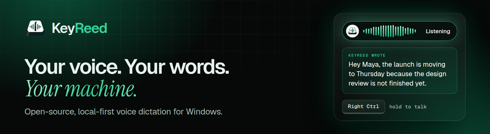
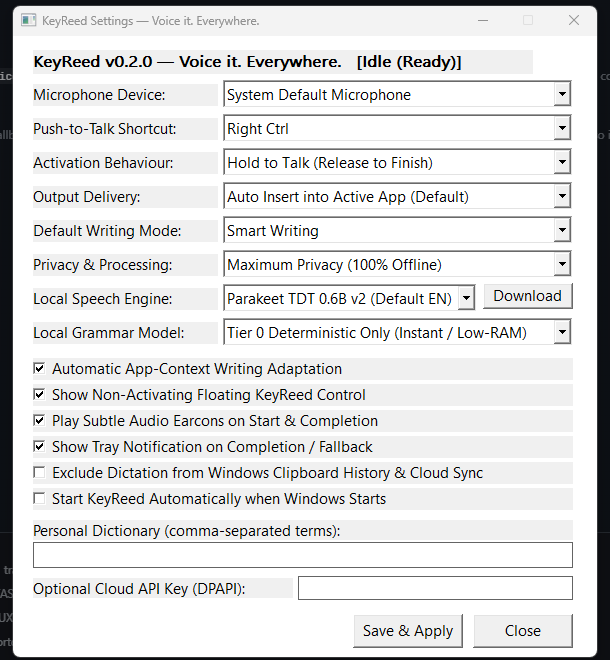
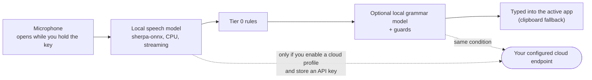

<div align="center">
  <br />
  <a href="https://www.keyreed.com">
    
  </a>
  <br /><br />
  <p>
    <a href="https://github.com/Shanmukh-l33t/keyreed/releases/latest"></a>
    <a href="https://github.com/Shanmukh-l33t/keyreed/actions/workflows/ci.yml"></a>
    
    
    
  </p>
  <p>
    <a href="https://www.keyreed.com"><strong>Website</strong></a> ·
    <a href="https://github.com/Shanmukh-l33t/keyreed/releases"><strong>Download</strong></a> ·
    <a href="docs/installation.md"><strong>Install guide</strong></a> ·
    <a href="docs/architecture.md"><strong>Architecture</strong></a> ·
    <a href="docs/troubleshooting.md"><strong>Troubleshooting</strong></a> ·
    <a href="CONTRIBUTING.md"><strong>Contribute</strong></a>
  </p>
</div>

---

# KeyReed

**KeyReed is an open-source, local-first voice dictation and writing app for Windows.** Hold a shortcut, speak, release. KeyReed transcribes on your own PC, cleans the text up, and types it into whatever application you were using. Ctrl+Win+G fixes the text you selected; Ctrl+Win+K opens a small window that rewrites or shortens it.

It is built as an inspectable alternative to cloud dictation tools such as Wispr Flow: you can read the code, run it offline, and decide for yourself whether any audio ever leaves the machine.

> **Status:** **2.1.1**, released 18 November 2026. It fixes Quick Fix and the Composer working only some of the time, a crash when clicking the idle pill, and a slow, choppy installer. These were checked with automated tests and, for the installer, frame timing; dictation was not re-run by hand for this release, so review your first dictations. The Windows build is unsigned; read [Known limits](#known-limits) for details.

## What is new in 2.1

- **A new interface.** Light by default with a Dark mode switch in General, a raised Settings panel with a sliding selection and pages that rise in, and spring motion on a 60 Hz frame clock throughout. The listener shows lines of text while it works, and an idle window paints nothing.
- **Your vocabulary now reaches the decoder.** Parakeet runs `modified_beam_search` with hotwords when your dictionary has terms; before, they were passed to a greedy decoder that ignored them. Audio in is cleaner too: a polyphase windowed-sinc resampler, a 20 Hz DC blocker, a 30 ms windowed level gate that keeps quiet speech, and 200 ms of audio kept after key-up so the last word is not clipped.
- **Quick Fix.** Select text in any application and press **Ctrl + Win + G**. KeyReed proposes spelling and grammar corrections in a Review panel and replaces nothing until you confirm. Undo is on the pill. Everything runs on your PC.
- **The Composer.** **Ctrl + Win + K** (or Open the Composer in the tray menu) opens a small window with Fix, Improve, Shorter, Change tone, Summarise and your own instruction. It answers from the local writing model and starts no network call.
- **Eight speech models**, including two new ones: Parakeet 110M (light English) and Parakeet Ultra (25 languages). The default is still Parakeet TDT 0.6B v2.

## Quick start

1. Download **`KeyReed-Setup-x64.exe`** (`24.4 MB`) from the [2.1.1 release](https://github.com/Shanmukh-l33t/keyreed/releases/tag/v2.1.1).
2. Run it. It installs for your Windows account only, so it does not ask for administrator rights. SmartScreen may warn, because the file is unsigned. See [Verifying a download](docs/installation.md#verify-your-download).
3. On first launch, KeyReed opens the 4-step **Get started** setup (Welcome & shortcut → Microphone test → Speech model download → Live practice box). All changes save automatically.
4. Focus any text field, hold **Right Ctrl**, speak, and release.
5. KeyReed transcribes your speech, applies your selected writing mode, and **automatically inserts the text into your active window** (falling back to the clipboard if the target field is a password box, elevated, or unfocused).

No Rust, Python, Visual Studio or command line needed. There is also `keyreed-2.1.1-windows-x86_64-portable.zip` (`46.2 MB`), which holds the exe and its runtime DLLs but no models, so it cannot dictate until it downloads one. No full offline archive is built for this release.

## Why KeyReed

| | |
| --- | --- |
| **Open source** | A public Rust workspace under MIT or Apache-2.0, your choice. |
| **Local by default** | The default profile, Maximum Privacy (100% Offline), makes no network call for audio or text. |
| **System-wide** | A global shortcut that works in any application, not a plugin for one editor. |
| **Six writing modes** | Smart, Exact, Professional, Casual, Technical and Terminal / Code. |
| **Speak it, fix it, write it** | Dictation, a selection fixer with a review panel, and a small writing window, all on your PC. |
| **No GPU needed** | Speech recognition runs on the CPU. The optional grammar model uses a Vulkan GPU when present and falls back to the CPU. |
| **Streams while you talk** | Speech is decoded during the recording, so a 47 s dictation was ready 0.5-0.7 s after release on a 2018 laptop CPU (synthetic test audio, [method](docs/research/08-e2e-speed-accuracy-worklog.md)). |
| **Checked models** | Every model file is verified against a compile-time size and SHA-256 before it loads. |

## What it looks like

<p align="center">
  
</p>
<p align="center">
  
</p>
<p align="center"><sub>Real captures from KeyReed 0.5.0 on Windows 11. Settings follows the Windows light or dark app mode.</sub></p>

The [website](https://www.keyreed.com) has an animated walkthrough of the dictation flow (an illustration, not a recording) and an honest [KeyReed vs Wispr Flow](https://www.keyreed.com/vs-wispr-flow) comparison.

## Features

- **Hold-to-talk or toggle-to-talk.** Right Ctrl by default; the shortcut is a preset list in Settings. Escape cancels a recording.
- **Compact icon-first floating listener.** `36×36` logical pixels at idle (with zero background timer activity), expanding smoothly to `98×36` with an 11-bar measured microphone RMS waveform while recording, deliberate 380 ms hover expansion, quiet 1.6 s mode-switch hints, and Per-Monitor-v2 DPI scaling across multi-monitor setups.
- **Dark and light Settings** that follow the Windows app mode, with WCAG 2.2 AA contrast checked by a unit test.
- **10-page instant-apply Settings & 4-step guided onboarding.** Organised sidebar navigation (`Get started`, `General`, `Dictation`, `Writing`, `Output`, `Microphone`, `Speech models`, `Processing`, `Privacy`, `About`) where every toggle, choice card, dropdown, and personal dictionary entry saves immediately.
- **Writing modes.** See [below](#writing-modes). Cycle them with Ctrl+Shift+Space, or let automatic app-context adaptation choose.
- **Grammar correction.** Deterministic Tier 0 rules first (fillers, stutters, spoken self-corrections, casing, your vocabulary), then an optional local grammar model (skipped when the sentence is already clean), then guards that fall back to Tier 0 if the model output drifts.
- **Long dictation.** Up to 30 minutes per recording, decoded while you talk and split into paragraphs from your pauses. At the cap the recording is processed, not thrown away.
- **Personal vocabulary.** Teach it names and jargon in Settings (a Term and a Sounds like row per entry). Those terms now bias the Parakeet decoder through `modified_beam_search`, not only the casing pass.
- **Quick Fix.** Select text in another application and press **Ctrl + Win + G**. Spelling (the Windows spell checker) and grammar (the local `gector-bert-en` tagger) are proposed in a Review panel; Enter replaces, Esc dismisses, and Undo is on the pill for a few seconds. Review is the default; silent replace is a Settings switch.
- **The Composer.** **Ctrl + Win + K**, or Open the Composer in the tray menu, gives you Fix, Improve, Shorter, Change tone, Summarise and your own instruction. The answer streams, Esc cancels, and you can replace the selection, insert, copy or regenerate. It runs on the local writing model.
- **Output choice.** Auto Insert (default: types into the focused field, falls back to the clipboard for password fields or elevated windows), Clipboard Only, or Ask Before Inserting (3-option `Yes` / `No` / `Cancel` dialog).
- **Microphone selection & diagnostics**, live level meter and plain-language health verdicts (`Sounds good`, `Quiet`, `No sound`, `Too loud`), a button that opens Windows microphone privacy settings when capture fails, automatic fallback to the default microphone when a device is unplugged, audio cues, **Reset to defaults**, and optional startup with Windows (off by default).
- **Eight speech models**, all verified against compile-time SHA-256 pins with measured CPU speeds, live MB/% download progress, cancellation, and one-click model switching. Parakeet TDT 0.6B v2 (default), v3 and Ultra cover English and 25 European languages; Parakeet 110M is the light English option. See [docs/architecture.md](docs/architecture.md#speech-models).
- **Optional cloud profiles** (Balanced, Maximum Accuracy) for people who bring their own API key.

## Writing modes

| Mode | What it does | Chosen automatically for |
| --- | --- | --- |
| **Smart** (default) | Natural, clear sentences. Removes fillers, resolves self-corrections. | Documents, notes |
| **Exact** | Casing and punctuation only. No rephrasing. | Password-protected windows |
| **Professional** | Concise, workplace tone. | Mail |
| **Casual** | Relaxed chat tone, keeps contractions. | Chat |
| **Technical** | Preserves identifiers, acronyms, versions, paths and numbers. | Code editors |
| **Terminal / Code** | Compiles spoken flags, pipes and paths into command syntax. Warns before destructive commands. | Terminals |

Spoken symbols such as "forward slash" apply only in Terminal / Code. Without the local grammar model installed, Smart, Professional, Casual and Technical use deterministic rules only.

## Usage

| Action | Default |
| --- | --- |
| Record | Hold **Right Ctrl**, release to finish |
| Fix the selected text | **Ctrl+Win+G** |
| Open the Composer | **Ctrl+Win+K**, or Open the Composer in the tray menu |
| Cancel a recording | **Esc** |
| Cycle writing mode | **Ctrl+Shift+Space** |
| Paste again (or in Clipboard Only mode) | **Ctrl+V** |

Recordings are capped at 30 minutes; at the cap the recording is processed rather than discarded. Escape, a lost key release or a session lock cancels instead of typing something partial. Clicking the floating listener starts dictation by default.

Useful command-line flags for `keyreed.exe`: `--help`, `--version`, `--settings`, `--list-models`, `--download-model <id>`, `--print-foreground`.

## Privacy and architecture



- The default profile makes no network call for audio or text. A unit test in the source holds it to that.
- The network is used to download a speech model, and by the cloud profiles if you turn them on.
- Audio is kept in memory, is not written to a file on the normal path, and is wiped after decoding.
- Cloud API keys are stored DPAPI-encrypted. KeyReed ships no key.
- When KeyReed falls back to the clipboard, the text stays there until you replace it. You can exclude it from Windows Clipboard History in Settings (on by default for new settings).
- Quick Fix and the Composer run on this PC: spelling through the Windows spell checker, grammar and rewriting through the local models. They start no network call.
- The style store and the edit watcher from the 2.0 plan are in the source with their tests, but nothing calls them yet, so no text of yours is read back or learned from in this build.
- No independent network capture of the offline profile has been published yet.

Details: [docs/architecture.md](docs/architecture.md).

## System requirements

| | |
| --- | --- |
| OS | 64-bit Windows 11 (the interface was run and captured on it). Windows 10 64-bit is supported by the code but was not re-tested. |
| CPU / GPU | x64, no GPU required. The optional grammar model uses a Vulkan GPU if present (`KEYREED_SLM_DEVICE=cpu` turns that off). |
| Disk | A 24.4 MB installer plus about 460 MB for the default speech model, and 73 MB for Quick Fix's grammar model if you turn it on. |
| RAM | On a 3-core, 4 GB test VM the app and local grammar runtime used roughly 1.6 GB together. More free memory is safer. An 8 GB PC has not been benchmarked. |
| Other | A microphone that desktop apps may use. |

## Build from source

```powershell
git clone https://github.com/Shanmukh-l33t/keyreed.git
cd keyreed
cargo test --workspace
cargo build --release -p vi-app
```

Rust 1.80 or newer. Release builds: `scripts/build-release.sh`; installer: `scripts/build-installer.sh` (NSIS, with `--test` for a sandboxed QA build checked by `scripts/installer/test_installer.py`). Full instructions: [docs/development.md](docs/development.md).

## Known limits

- Dictation was **not re-run by hand for 2.1.1**. Beam search with hotwords, the new resampler and the post-release tail have not been benchmarked on a real microphone. The interface was run on Windows 11 by the automated gallery (every page, state and animation, light and dark).
- The Windows executable, bundled runtimes and installer are **unsigned**. SmartScreen behaviour has not been observed for this download.
- Quick Fix has not been checked by hand in Chromium-based apps, Outlook or Word; the automated check ran in a plain Windows edit control. English only.
- The Composer needs the local writing model (Qwen3.5 0.8B) installed; without it, a request stops with a message instead of sending anything. There is no Settings picker for it yet.
- Voice commands, a "My style" Settings page, and learning from your edits are not wired up in this build, even though the style store and edit watcher exist in the source.
- Speed and accuracy figures come from one laptop (i7-8850H, Quadro P2000) and an older build, mostly with synthetic speech. Live microphone dictation with real voices in noisy rooms has not been benchmarked.
- Auto Insert types at about 600 characters per second into a plain text box, so very long dictations take a few seconds to appear.
- The GPU grammar path was tested on one NVIDIA card only, and not on a machine without a Vulkan driver.
- Hindi transcription accuracy is unscored. Do not treat one clip, or a text-only rewrite check, as a word error rate.
- Windows 10 was not re-tested, and a 4-core, 8 GB machine was not measured.

The full audit trail is in [docs/release](docs/release).

## Roadmap

This is a list of open items taken from the release audits, not a promise of dates.

| Status | Item |
| --- | --- |
| Done | Installer without bundled models, checked model downloads, tray GUI build (0.1.1) |
| Done | Hold and toggle activation, six writing modes, Tier 0 rules, local grammar model, guards |
| Done | Quick Fix with the Review panel and Undo, the Composer, vocabulary that reaches the decoder, eight speech models (2.1) |
| Open | Voice commands, a "My style" page, and learning from your edits |
| Open | Code signing and SmartScreen reputation |
| Open | Physical-desktop validation: microphone loop, paste read-back, app-context rows |
| Open | Windows 10 test pass and an 8 GB hardware benchmark |
| Open | Scored Hindi accuracy |

## Contributing

Small, tested pull requests are welcome. Start with [CONTRIBUTING.md](CONTRIBUTING.md). Report vulnerabilities privately as described in [SECURITY.md](SECURITY.md).

## Licence

Dual licensed under [MIT](LICENSE-MIT) or [Apache-2.0](LICENSE-APACHE), at your option, as declared in `Cargo.toml`. Speech and grammar models are downloaded separately and carry their own licences. Website fonts (Geist, Instrument Serif) are under the SIL OFL 1.1.

## Links

[Website](https://www.keyreed.com) · [Releases](https://github.com/Shanmukh-l33t/keyreed/releases) · [Issues](https://github.com/Shanmukh-l33t/keyreed/issues) · [Changelog](CHANGELOG.md)

KeyReed is an independent project and is not affiliated with Wispr or any other company named here.
