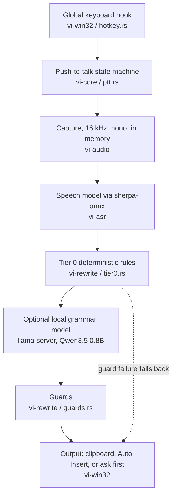

# Architecture

KeyReed is a Rust workspace. This page describes what the code does today, not what is planned.

## Dictation pipeline

1. **Hotkey.** A low-level keyboard hook on its own thread watches the configured trigger, Escape and the mode-cycle shortcut. Key repeat is ignored. Minimum hold is 110 ms.
2. **Capture.** The microphone opens when recording starts. After the key is released it keeps recording for 200 ms, up to 600 ms while you are still speaking, so the last word is not clipped; it then closes. Audio is resampled to 16 kHz with a windowed-sinc low-pass filter. A 30 minute recording is processed at the cap, not discarded. Audio stays in memory and is zeroized after decode.
3. **Transcription.** sherpa-onnx runs the selected speech model on the CPU. When your personal vocabulary is not empty and the model is a Parakeet transducer, the recognizer uses `modified_beam_search` with a BPE vocabulary derived from the model's `tokens.txt` so your terms bias decoding; with an empty vocabulary it uses the faster greedy search. Quiet recordings are judged by a 30 ms windowed level gate, not the clip average.
4. **Tier 0.** Fillers, stutters and spoken self-corrections are removed, casing and your vocabulary are applied, and Terminal / Code mode compiles spoken flags and paths into commands. Likely silence hallucinations are dropped.
5. **Grammar model.** If installed, a small local model polishes Smart, Professional, Casual and Technical text. Exact and Terminal / Code do not rephrase.
6. **Guards.** The model output is rejected, and Tier 0 text is used, if it is empty, starts with assistant chatter, changes numbers or identifiers, or is far longer or shorter than the input.
7. **Output.** The default writes the text to the clipboard. Auto Insert types into the focused field and falls back to the clipboard when that is unsafe.

## Processing profiles

| Profile | Network | Behaviour |
| --- | --- | --- |
| Maximum Privacy (100% Offline), **default** | Never used for audio or text | Local speech and local rewrite only |
| Balanced (Local First) | Possible | Local first, optional cloud fallback when configured |
| Maximum Accuracy (Hybrid / Cloud) | Possible | Uses the configured cloud endpoints when online, falls back to local |

Cloud endpoints are OpenAI-compatible and HTTPS only. The defaults in the settings point at Groq's API and are editable. The API key is stored DPAPI-encrypted, and there is no bundled key.

## Speech models

All are INT8 and run on the CPU. Figures are approximate catalog values from `crates/vi-asr/src/catalog.rs`.

| Id | Languages | Download | RAM |
| --- | --- | --- | --- |
| `parakeet-tdt-0.6b-v2-int8` (default) | English | 460 MB | 690 MB |
| `parakeet-tdt-0.6b-v3-int8` | 25 European languages | 465 MB | 710 MB |
| `parakeet-tdt-0.6b-ultra-int8` | 25 European languages (compare with v2 before relying on it) | 465 MB | 715 MB |
| `parakeet-tdt-110m-en-int8` | English, low-RAM tier | 103 MB | 190 MB |
| `whisper-small.en-int8` | English | 606 MB | 440 MB |
| `sense-voice-small-int8` | en, zh, ja, ko, yue | 999 MB | 290 MB |
| `moonshine-base-en-int8` | English | 239 MB | 165 MB |
| `moonshine-tiny-en-int8` | English | 103 MB | 95 MB |

Model licences differ (CC-BY-4.0, MIT, FunASR Model License). Check each model before redistributing.

## Integrity

Each catalog entry pins an expected size and SHA-256. Downloads are HTTPS only, extracted with path-traversal checks, and hashed before they are activated. An existing folder is hashed before load; a partial extract is not treated as installed.

## Where things live

| Data | Location |
| --- | --- |
| Settings | `%LOCALAPPDATA%\Keyreed\config.json` |
| History (off by default) | `%LOCALAPPDATA%\Keyreed\history.json` |
| Models | `%LOCALAPPDATA%\Keyreed\models`, or the install folder for the full package |

## Further reading

The release audits in [docs/release](release) record what was measured and what was not. Start with [06-known-limitations-and-blockers.md](release/06-known-limitations-and-blockers.md).
