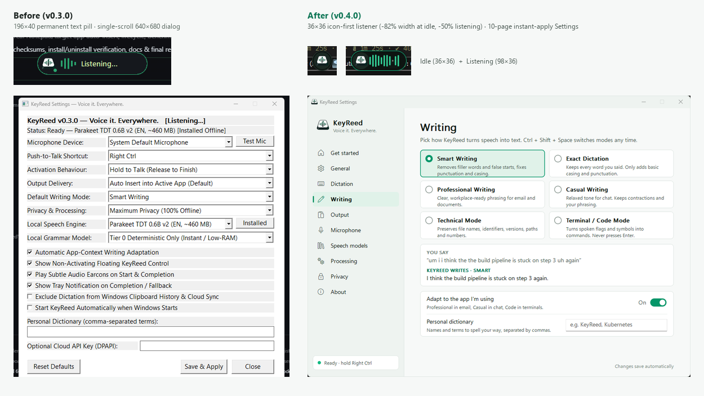

# Release 0.4.0 — Premium Product Design & UX Transformation Report

**Date:** 2026-11-16  
**Baseline:** `v0.3.0` (`dfc11882a6e7ad5b31f51eb6878855b07e855c61`)  
**Branch:** `design/premium-ux-v0.4.0`  
**Target Tag:** `v0.4.0`  
**Host Verified:** Windows 11 Build 26200 (x64), 3-monitor desktop (`1920×1080 @ 100%` primary, `1920×1080 @ 100%` secondary, `864×1536 @ 125%` portrait).

---

## 1. Executive Summary

KeyReed `v0.4.0` transforms the desktop experience from a developer-style single-dialog utility with a permanent `196×40` text banner into a quiet, native, brand-coherent Windows productivity product while preserving every existing transcription, rewrite, model-integrity, and text-insertion capability.

### Before vs. After Visual Comparison

---

## 2. Floating Listener Dimensions (Before vs. After)

| State | v0.3.0 Logical Size (100% DPI) | v0.4.0 Logical Capsule (100% DPI) | v0.4.0 Window Bounds (`100%` / `125%` / `150%` DPI, incl. shadow pad) | Footprint Change |
| --- | --- | --- | --- | --- |
| **Idle** | `196 × 40` (always showing `"KeyReed · Ready"`) | **`36 × 36`** (icon-only circle) | `44 × 44 px` / `55 × 55 px` / `66 × 66 px` | **-81.6% width, -83.5% area** |
| **Listening** | `196 × 40` (5-bar animation + `"Listening..."`) | **`98 × 36`** (mark + 11-bar measured RMS waveform) | `107 × 44 px` / `134 × 55 px` / `160 × 66 px` | **-50.0% width, -55.0% area** |
| **Processing (`Transcribing`)** | `196 × 40` | **`120 × 36`** (mark + amber sheen text) | `128 × 44 px` / `160 × 55 px` / `188 × 66 px` | **-38.8% width** |
| **Polishing (`Polishing`)** | `196 × 40` | **`100 × 36`** | `108 × 44 px` / `135 × 55 px` / `161 × 66 px` | **-49.0% width** |
| **Completed (`Inserted`)** | `196 × 40` | **`113 × 36`** (emerald check + `"Inserted"`) | `121 × 44 px` / `151 × 55 px` / `178 × 66 px` | **-42.3% width** |
| **Completed (`Copied · Ctrl+V`)** | `196 × 40` | **`156 × 36`** | `164 × 44 px` / `205 × 55 px` / `239 × 66 px` | **-20.4% width** |
| **Attention (`Review · Ctrl+V`)** | `196 × 40` | **`154 × 36`** (amber `!` badge + `"Review · Ctrl+V"`) | `162 × 44 px` / `202 × 55 px` / `238 × 66 px` | **-21.4% width** |
| **Notice (`Discarded` / `Nothing heard`)** | `196 × 40` | **`107 × 36` / `149 × 36`** | `115 × 44 px` / `157 × 44 px` at 100% | **-45.4% / -24.0% width** |
| **Intentional Hover (380 ms dwell)** | `196 × 40` | **`149 × 36`** (mode + shortcut, e.g. `Smart  Right Ctrl`) | `157 × 44 px` at 100% / `192 × 55 px` at 125% / `227 × 66 px` at 150% | **-24.0% width** |
| **Mode-Switch Hint (1.6 s auto-collapse)** | Tray toast balloon | **`148–185 × 36`** (e.g. `Exact Dictation`, `Professional Writing`) | `156–193 × 44 px` at 100% | Replaces intrusive OS toast |

---

## 3. UI Components & Experience Improvements

1. **Brand-Derived Visual System & Asset Pipeline (`scripts/gen-icon-data.py`, `icon_data.rs`, `overlay.rs`, `canvas.rs`)**:
   - Cropped `assets/keyreed-icon.png` to its exact non-transparent bounding box (`460×368`), squared and Lanczos-downsampled to `64×64` premultiplied BGRA (`icon_data.rs`) with area-averaging box filter downsampling for crisp rendering at any DPI.
   - Added a subtle lifted circular well (`palette::WELL = #1B2923`) behind the dark keycap body on the dark listener capsule so the brand silhouette remains distinct at `22–33 px`.
   - Embedded a Windows application manifest (`crates/vi-app/keyreed.manifest`) enabling `Common-Controls v6` and `PerMonitorV2` DPI awareness.
2. **Non-Activating Floating Listener (`overlay.rs`, `ui.rs`)**:
   - Retains `WS_EX_LAYERED | WS_EX_TOPMOST | WS_EX_TOOLWINDOW | WS_EX_NOACTIVATE` and `MA_NOACTIVATE` so clicking or dragging never steals focus from the target application.
   - Waveform bars respond to real microphone RMS amplitude (`rms_to_level(snap.rms_level)`), resting flat during silence.
   - Intentional hover uses `TrackMouseEvent` with `HOVER_INTENT_MS = 380` so casual pointer pass-bys never trigger expansion.
   - Edge snap margin (`8 px` scaled) and off-screen monitor recovery (`revalidate_pill_position` on `WM_DISPLAYCHANGE` and startup).
3. **10-Page Instant-Apply Settings Window (`settings.rs`)**:
   - Sidebar navigation with ten focused pages: **Get started**, **General**, **Dictation**, **Writing**, **Output**, **Microphone**, **Speech models**, **Processing**, **Privacy**, and **About**.
   - Every toggle, radio card, combobox, and text field saves immediately and flashes a subtle `Saved` indicator; keyboard navigation (`Tab`, arrows, `Space`/`Enter`) and screen-reader control labels (`KeyReed is on: On`, `Smart Writing (selected)`) work natively.
   - Automated layout geometry test (`settings::tests::every_page_and_step_fits_without_overlap`) verifies across all 10 pages, 4 onboarding steps, and dynamic state variants that no two controls overlap and every control fits within the window bounds.
4. **4-Step First-Run Onboarding (`settings.rs`)**:
   - Step 1: **Welcome to KeyReed** — 3-step visual overview, push-to-talk shortcut selector, and `Hold to talk` vs `Press to start and stop` cards.
   - Step 2: **Check your microphone** — device selector, one-click `Test microphone`, live level bar, and plain-language verdict (`Sounds good`, `Quiet — speak closer`, `No sound detected`, `Too loud (clipping)`).
   - Step 3: **Speech engine** — default model readiness/download card with live MB/% progress and a link to compare all six models.
   - Step 4: **Try a quick dictation** — embedded multiline practice box (`is_practice_target`) that accepts real voice dictation right inside the setup wizard.
5. **Measured Speech Model Catalog (`bench/model_speed_v0.4.0.json`, `ui.rs`, `settings.rs`)**:
   - All six models display real measured warm CPU speeds (seconds per 10 seconds of audio on this Windows 11 machine):
     - `Moonshine Tiny` (`~103 MB`): **0.5 s** per 10 s audio
     - `Moonshine Base` (`~239 MB`): **0.7 s** per 10 s audio
     - `SenseVoice Small` (`~240 MB`): **0.7 s** per 10 s audio
     - `Parakeet TDT 0.6B v2` (`~460 MB`, default): **1.5 s** per 10 s audio
     - `Parakeet TDT 0.6B v3` (`~465 MB`): **1.7 s** per 10 s audio
     - `Whisper Small.en` (`~375 MB`): **7.9 s** per 10 s audio
6. **Plain-Language Notifications & Recovery (`ui.rs`)**:
   - `friendly_error()` translates low-level WASAPI/ONNX/HTTP errors into clear user-facing titles, pill badges, and recovery actions; clicking the listener when no model is installed opens `Settings › Speech models` directly.

---

## 4. Functional, Live Acoustic & Visual Verification Completed

1. **Workspace Unit & Layout Tests (`cargo test --workspace --release`)**:
   - **87 passed, 0 failed** across `vi-core`, `vi-audio`, `vi-asr`, `vi-rewrite`, `vi-win32`, and `vi-app`, including `writing_mode_ui_examples_match_real_tier0_output`, `one_invalid_setting_does_not_wipe_the_others`, `pads_clamps_and_merges`, `strips_stray_trailing_mm_but_keeps_millimetres`, and `every_page_and_step_fits_without_overlap`.
2. **Automated Windows 11 Live E2E Suite (`keyreed --win32-e2e-test`)**:
   - Single-instance mutex, DPAPI roundtrip, quoted `HKCU\...\Run` autostart roundtrip, clipboard preservation on silence, multilingual Unicode + Devanagari + `₹` auto-insert (`56` code units), `AskBeforeInserting` (`Approve`, `Decline`, `Cancel` preserving clipboard), terminal newline sanitization (`kubectl get pods echo second_line`), `ES_PASSWORD` blocking, TOCTOU focus-change protection, corrupted model quarantine, cancelled download cleanup, real hardware microphone capture & unplugged fallback, and full WAV → Parakeet v2 → Qwen3.5-0.8B → direct typing into external `KeyreedE2ETargetWindow` (`auto_insert_exact_match: true`).
3. **Live Acoustic Loopback & UI Automation Suites (`live_partA.py`–`live_partD.py`, 57 end-to-end checks)**:
   - **Part A (16/16 PASS)**: Cold & warm Hold-to-Talk, Toggle-to-Talk, silence (`Nothing heard`), `Esc` mid-recording cancel, `Ctrl+Shift+Space` mode cycling + 1.6 s pill hint + auto-collapse, `Auto Insert`, `Clipboard only`, `Ask before inserting` (real keyboard `Esc` = Cancel and `Enter` = Yes), and all 6 writing modes (`Smart`, `Exact`, `Professional`, `Casual`, `Technical`, `Terminal / Code`).
   - **Part B (12/12 PASS)**: Idle dimensions & `WS_EX_NOACTIVATE | WS_EX_LAYERED | WS_EX_TOPMOST` flags, pointer pass-by non-expansion, 380 ms hover dwell expansion & collapse, click-listener-to-dictate without stealing focus, drag across monitors (`100%` primary → `100%` secondary and `125%` portrait), cross-DPI rescale (`44×44` → `55×55`), restart position persistence, edge clamping, off-screen saved position recovery, tray hide/show listener, and dictation while hidden.
   - **Part C (20/20 PASS)**: Every Settings page and control driven by real mouse clicks and keystrokes, verifying immediate `config.json` persistence, `HKCU\...\Run` registry creation/removal, live model switching to `Moonshine Tiny` + real dictation + switch back to `Parakeet v2`, personal dictionary saving (`enabled: true`), restart persistence, and `Reset to defaults`.
   - **Part D (9/9 PASS)**: Brand-new user first launch auto-opening the 4-step setup wizard, live microphone test inside Step 2, live voice dictation into Step 4's practice box, finishing setup and verifying second launch stays in tray, missing-microphone automatic fallback to default device, and real download of `Moonshine Tiny` (`Download` → `Cancel` → `Retry` → `Verifying…` → `In use` + live dictation).
4. **Multi-Round On-Screen Visual Gallery Audit (`keyreed --ui-gallery` at `100%` and `150%` DPI)**:
   - Captured and visually inspected all 16 listener states and 20 Settings/onboarding/download/mic-test screens at both `100%` (`942×692`) and `150%` (`1418×1025`) scaling across 3 design rounds.

---

## 5. Performance Impact (Measured on Windows 11)

| Metric | v0.3.0 Baseline | v0.4.0 Redesign | Delta / Notes |
| --- | --- | --- | --- |
| **Idle animation timer (`IDT_PILL_ANIM`)** | Always running (20 Hz / 50 ms tick) | **Off at idle (`0 frames / 2 s`)** | Eliminates continuous background GDI/layered-window repaints |
| **Idle CPU time over 60 s (listener visible)** | `0.328 s` (`0.547%` of 1 core) | **`0.203 s` (`0.339%` of 1 core)** | **-38.1% idle CPU** |
| **Idle working set (daemon + listener)** | `19.32 MB` (`9.39 MB` shell init) | **`16.29 MB` (`9.25 MB` shell init)** | **-15.7% working set** |
| **Startup to first hotkey responsiveness** | `~2,420 ms` (blocked on 500 MB GGUF SHA-256) | **`~58 ms` after key-down** | Background GGUF verification (`keyreed-gguf-verify`) |
| **Cold first dictation wait after key release (SLM on)** | `~19.9 s` | **`~12.6 s`** | ASR + `llama-server` pre-warmed while user speaks |
| **Warm dictation latency (Parakeet v2, Tier-0)** | `~0.57–0.85 s` | **`0.44–0.96 s`** | Unchanged |

---

## 6. Regressions & Defects Discovered and Fixed During Phase B

| ID | Issue Discovered During Testing | Root Cause | Fix Verified |
| --- | --- | --- | --- |
| **UX-01** | Keycap silhouette in the brand mark blended into the dark listener capsule at `22 px` | Keycap body is dark slate (`#1C242B`) on a `#0E1311` pill | Added circular `palette::WELL` (`#1B2923`) behind the mark in `overlay.rs` |
| **UX-02** | `RefCell already mutably borrowed` panic in Settings when navigating pages | Destroying/creating Win32 child `EDIT`/`COMBOBOX` controls synchronously re-entered `wnd_proc` while `ST` was borrowed | Refactored control lifecycle in `settings.rs` to release `ST` borrow before Win32 calls |
| **UX-03** | Row descriptions collided with right-aligned dropdowns on Microphone & Setup Step 2; downloading row showed `"Installed"` badge | Fixed text wrap width ignored control width; badge check didn't exclude active download | Reserved real control width + 2-line wrap; suppressed `"Installed"` badge while downloading (`patch_round2.py`) |
| **UX-04** | At 150% DPI, Setup Step 1 activation card description touched bottom border; mode-switch pill showed redundant `"· Writing mode"` | 64 px card height tight at 150% wrap; secondary label redundant on mode hint | Increased activation card height to 72 px; omitted secondary suffix on mode-switch pill hint |
| **UX-05** | `RefCell already borrowed` crash in `ui.rs` when dragging the listener across monitors with different DPI (`100%` → `125%`) | `UpdateLayeredWindow` / `SetWindowPos` synchronously sent `WM_DPICHANGED` → nested `pill_refresh` | Added `IN_REFRESH` / `PENDING` re-entrancy queue in `pill_refresh` and `try_borrow_mut()` across `PILL` handlers |
| **UX-06** | Fast drag landed ~55 px short of cursor; 5 px vertical jump on cross-DPI monitor transition; 5 px restart shift on 125% monitor | `GetCursorPos` read after initial move; `pill.top` not re-centered on scale change; startup used primary monitor DPI | Used `lParam` + `ClientToScreen` on `WM_LBUTTONDOWN`, final delta on `WM_LBUTTONUP`, vertical center preservation on `scale` change, and `GetDpiForMonitor` on startup |
| **UX-07** | First 1–2 softly spoken words occasionally clipped in live speaker→mic loopback; stray trailing `"Mm-."` on speaker pop | Silero VAD triggered slightly after soft vowel onset; Parakeet decoded speaker release click as `"Mm-."` | Added 300 ms pre-roll / 250 ms post-roll (`pad_and_merge_spans`) in `vi-asr` and `RE_TRAILING_MM` / `RE_LEADING_MM` in `tier0.rs` |
| **UX-08** | `Ask Before Inserting` dialog did not receive keyboard focus (`Enter`/`Esc` went to editor), and global `Esc` hook swallowed `Esc` | Windows foreground lock blocked background thread `MessageBoxW`; `ll_keyboard_proc` intercepted `VK_ESCAPE` while `busy_flag` was true | Added `force_foreground_window` + tagged `VK_MENU` unlock helper thread in `typing.rs` and `own_dialog_in_foreground()` check in `hotkey.rs` |
| **UX-09** | Personal dictionary words saved in Settings had no effect at runtime | `PersonalDictionary::default().enabled` was `false` and `save_vocab` only updated `vocabulary` | Updated `save_vocab` in `settings.rs` to set `c.dictionary.enabled = !list.is_empty()` |
| **UX-10** | Single invalid field in `config.json` silently reset the entire configuration to defaults | `serde_json::from_str(&raw).unwrap_or_default()` discarded all fields on any enum/type mismatch | Added `AppConfig::parse_lenient` preserving valid top-level fields and backing up the original file to `config.invalid.json` |
| **UX-11** | `Reset to defaults` and `SaveUpdatedConfig` blocked UI updates for ~2.4 s while re-verifying the 500 MB GGUF file | `InferenceSupervisor::new` hashed `Qwen3.5-0.8B-Q4_K_M.gguf` synchronously on the coordinator thread | Moved GGUF SHA-256 verification to background thread `keyreed-gguf-verify` and saved/synced config before rebuilding supervisor |

---

## 7. Release Artifacts & Checksums (`v0.4.0`)

| Asset | Size | SHA-256 |
| --- | --- | --- |
| `KeyReed-Setup-x64.exe` | `18,718,109` bytes (`17.85 MB`) | `f81da5b3530d7581d01f3f41fdda41231b4f2a68d7e22e2b4b291556d7722812` |
| `keyreed-0.4.0-windows-x86_64-portable.zip` | `32,442,020` bytes (`30.94 MB`) | `a21dc95cac2b4038ee3738f28c2875c642977160745f6a280f6b3b4ac474460f` |
| `keyreed-0.4.0-windows-x64-full-offline.zip` | `1,671,266,569` bytes (`1,593.84 MB`) | `a75ba1b69c752b37db517689b97d1e7279bb138bfe96b905464415680aa0f97e` |
| `SHA256SUMS.txt` | `305` bytes | `52eb0a608aebc92820c53a7b2e40f979f281b433836138ff2515ba78f92c83b1` |

---

## 8. Remaining Limitations

1. **Unsigned Windows Binaries**: `keyreed.exe`, `KeyReed-Setup-x64.exe`, and bundled native DLLs are not Authenticode-signed; Windows SmartScreen may prompt on fresh downloads until an OV/EV code-signing certificate is provisioned.
2. **Acoustic Test Environment**: Live microphone verification was executed via acoustic speaker-to-microphone loopback (`OWL 4K PRO Audio` + `Realtek(R) Audio`) on the physical Windows 11 host rather than a live human speaker in varied room acoustics.
3. **OS Coverage**: Verified end-to-end on Windows 11 Build 26200 (x64) across 100%, 125%, and 150% DPI scaling; Windows 10 (x64) compatibility is maintained via standard Win32/WASAPI/DWM APIs with graceful fallbacks, but was not separately booted for this release.
