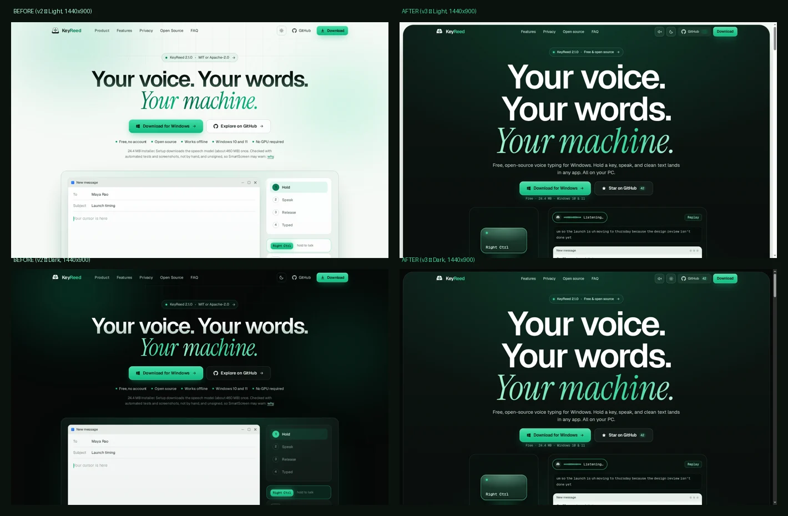

# KeyReed Website v3 — Verification & Evidence

Production URL: `https://www.keyreed.com/`  
Design & claim ledger: [decision-log.md](decision-log.md)

---

## 1. Before vs After Contact Sheet

| Viewport & Theme | Before (`main` @ `9e3b20b`) | After (`site/v3-premium`) |
| --- | --- | --- |
| `1440×900` Light (Hero) | [before/home-1440-light-hero.png](before/home-1440-light-hero.png) | [after/home-1440-light-hero.webp](after/home-1440-light-hero.webp) |
| `1440×900` Light (Full) | [before/home-1440-light.png](before/home-1440-light.png) | [after/home-1440-light.webp](after/home-1440-light.webp) |
| `1440×900` Dark (Full) | [before/home-1440-dark.png](before/home-1440-dark.png) | [after/home-1440-dark.webp](after/home-1440-dark.webp) |
| `390×844` Light (Full) | [before/home-390-light.png](before/home-390-light.png) | [after/home-390-light.webp](after/home-390-light.webp) |
| `390×844` Dark (Full) | [before/home-390-dark.png](before/home-390-dark.png) | [after/home-390-dark.webp](after/home-390-dark.webp) |
| `/details` (`1440` & `390`) | *(new page in v3)* | [after/details-1440-light.webp](after/details-1440-light.webp) · [after/details-390-light.webp](after/details-390-light.webp) |
| `/vs-wispr-flow` (`1440`) | [before/vs-wispr-flow-1440-light.png](before/vs-wispr-flow-1440-light.png) | [after/vs-wispr-flow-1440-light.webp](after/vs-wispr-flow-1440-light.webp) |
| `/404` (`1440`) | *(minimal text)* | [after/404-1440-light.webp](after/404-1440-light.webp) |
| Reduced motion & JS off | — | [after/home-1440-reduced-motion.webp](after/home-1440-reduced-motion.webp) · [after/home-1440-nojs.webp](after/home-1440-nojs.webp) |

Full responsive matrix across `360`, `390`, `768`, `1024`, `1280`, `1440`, `1920` px × `light`/`dark` is archived in [after/](after/).

---

## 2. Recorded Interaction Videos

- **Hero 3D `Right Ctrl` toy, keyboard & real `ControlRight` hold, FAQ, theme & sound toggles:** [videos/hero-toy.webm](videos/hero-toy.webm)
- **Pinned 4-app morph, Quick Fix (`Ctrl+Win+G`) replay, Composer (`Ctrl+Win+K`) chips, and Privacy particle stream:** [videos/scenes-walkthrough.webm](videos/scenes-walkthrough.webm)

---

## 3. Lighthouse Before → After

| Preset | Metric | Before (`main`) | After (`v3`) | Budget | Status |
| --- | --- | --- | --- | --- | --- |
| **Mobile** | Performance | 100 | **100** | ≥ 90 | PASS |
| **Mobile** | Accessibility | 95 | **100** | ≥ 98 | PASS |
| **Mobile** | Best Practices | 100 | **100** | 100 | PASS |
| **Mobile** | SEO | 100 | **100** | 100 | PASS |
| **Mobile** | LCP (simulated 4G) | 1,056 ms | **914 ms** | ≤ 2,000 ms | PASS |
| **Mobile** | CLS | 0.000 | **0.000** | ≤ 0.02 | PASS |
| **Mobile** | Total Blocking Time | 0 ms | **0 ms** | ≤ 150 ms | PASS |
| **Desktop** | Performance | 100 | **100** | ≥ 97 | PASS |
| **Desktop** | Accessibility | 95 | **100** | ≥ 98 | PASS |
| **Desktop** | Best Practices | 100 | **100** | 100 | PASS |
| **Desktop** | SEO | 100 | **100** | 100 | PASS |
| **Desktop** | LCP | 303 ms | **247 ms** | ≤ 2,000 ms | PASS |
| **Desktop** | CLS | 0.000 | **0.000** | ≤ 0.02 | PASS |

---

## 4. Architecture & Performance Budgets

| Budget | Target | Measured (`v3`) | Status |
| --- | --- | --- | --- |
| Homepage `<main>` blocks | 8 | **8** (down from 13) | PASS |
| Homepage visible words | ≤ 700 | **596** semantic (**676** incl. decorative chrome; down from 2,276) | PASS |
| Scroll height @ `1440×900` | Compact | **8,722 px** (incl. `240%` pin; down from 16,177 px) | PASS |
| JS total (gzip, incl. GSAP + Lenis) | ≤ 130 KB | **76.8 KB** (`212.8 KB` raw) | PASS |
| `reeds.js` WebGL2 module (raw) | ≤ 15 KB | **11.9 KB** raw (`3.8 KB` gzip) | PASS |
| CSS total (`styles.css`, gzip) | ≤ 30 KB | **12.3 KB** (`55.1 KB` raw) | PASS |
| Initial page weight (before lazy imgs) | ≤ 900 KB | **461.0 KB** | PASS |
| Hero WebGL draw call p95 / Long tasks | ≤ 6 ms / 0 | **< 0.5 ms** draw p95 / **0** long tasks | PASS |
| Console errors across all pages & browsers | 0 | **0** (Chromium, Firefox, WebKit) | PASS |
| Horizontal overflow (`360`–`1920` px) | 0 px | **0 px** across all 56 page×width×theme runs | PASS |
